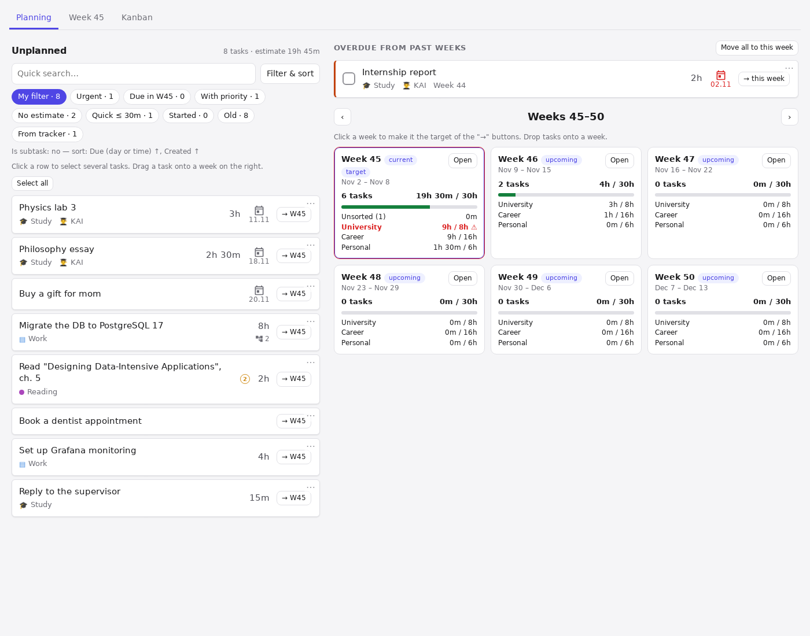
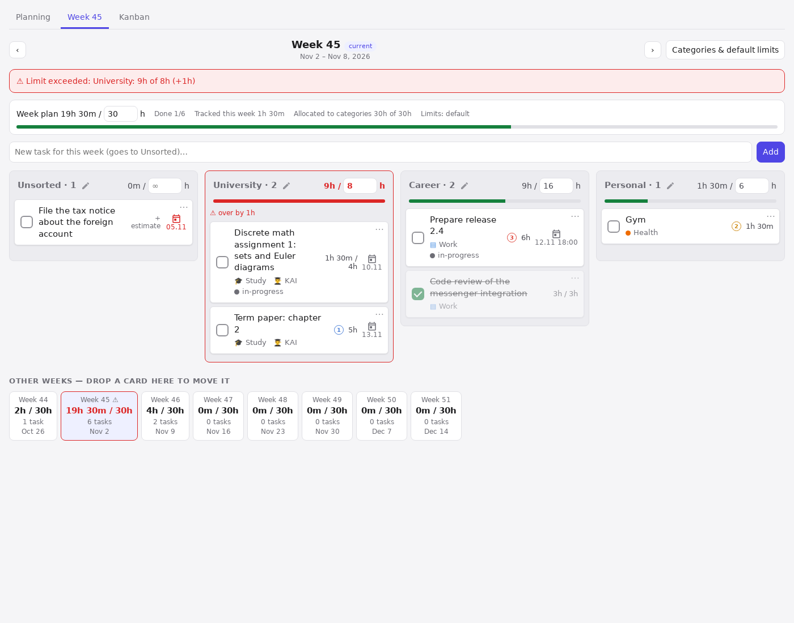
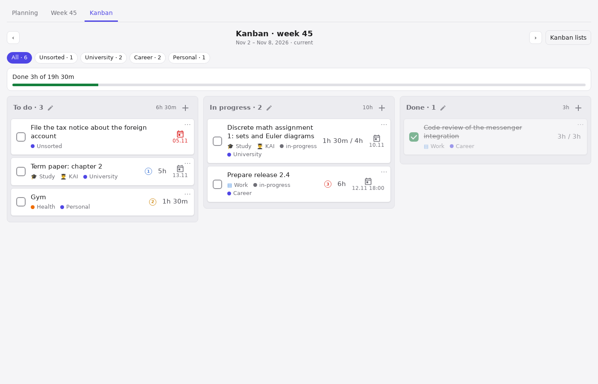
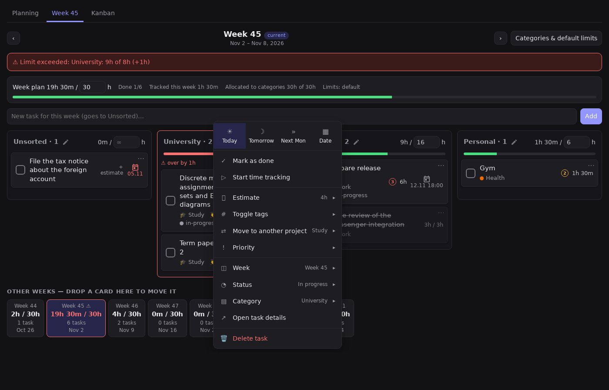

# Week Planner for Super Productivity

**English** · [Русский](README.ru.md)

Plugin for [Super Productivity](https://github.com/super-productivity/super-productivity) 20+:
plan tasks for whole weeks, sort them into categories with hour limits, and work through the week on a kanban board.

> **Status: early development (0.x).** Things may change between versions.
> Keep the automatic backups of Super Productivity enabled.

## Screens

The plugin opens from buttons in the Super Productivity header: "Week planner" and "Week kanban".
It has 3 tabs.

### Planning



- On the left is the "Unplanned" pool: open tasks without a week. Filter and sort it by any task field.
- Ready-made pool filters: "Urgent", "Due in W45", "With priority", "No estimate", "Quick ≤ 30m",
  "Started", "Old", "From tracker". "My filter" is set up with the "Filter & sort" button.
- On the right are the next 6 weeks. Each shows the load per category and the week plan in total.
- Drag a task onto a week or add it with the "→ W45" button. Click a week to choose where the buttons add tasks.
- At the top are overdue tasks from past weeks, with a button to move them to the current week.

### Week



- Columns are categories: "Unsorted", "University", "Career", "Personal".
- New tasks of the week go to "Unsorted". Drag a card to the right category.
- Cards look like on the Super Productivity board: checkbox, title, project and tags with icons, priority, estimate, due date.
- A card has no buttons except "⋯" on hover. Moving between weeks and "Remove from week" are in the task menu.
- Click the estimate on a card ("1h" or "+ estimate") to pick an estimate.
- Each category has its own hour limit, and the week has a total limit. Going over shows a banner, a red column and a notification.
- Week and category hours count an open task by its estimate and a done task by its spent time.
  A done task without spent time counts its estimate.
- Category limits together cannot exceed the week limit.
- The pencil next to the column title opens the filter and sort of that column. The filter only hides cards:
  hours and limits count all tasks of the column, and the header shows "hidden N". The settings apply to all weeks.
- Categories and **default limits** are set with the "Categories & default limits" button. All weeks get them.
- Limits in the column headers and on the panel change **this week only**. After the first change the week gets
  its own limits, and new default limits no longer change it. The "Use defaults" button drops the week's own limits.

### Kanban



- Columns "To do", "In progress", "Done" for the current week.
- Moving a task to "Done" marks it done in Super Productivity.
- The "In progress" column is linked with the `#in-progress` tag both ways. Moving a card to "In progress" sets the tag, moving it out removes the tag.
  A tag set or removed in Super Productivity itself moves the card on the next plugin refresh.
  If the tag does not exist, the plugin creates it. On the first run, tasks that were already "In progress" get the tag.
- Change the status by dragging, with the checkbox on the card, or with "Status" in the task menu.
- Category filter at the top.
- The "Kanban lists" button opens the column editor: rename and reorder the built-in lists, add your own or delete custom ones. Tasks of a deleted list go to "To do"; "Done" stays linked to task completion in Super Productivity.
- Kanban columns also have the pencil with filter and sort.
- Manual order: drop a card onto another card, and it goes before or after it.
  The column then switches to the "Manual order (drag)" sort. The pencil brings the previous sort back.
- The "+" button in the column header opens the usual add task bar of Super Productivity.
  Tasks created in this bar go to this kanban column, to the chosen week and category
  (no category chosen: "Unsorted"). The wait ends on the next click in the plugin or after 15 minutes.

### Task menu



Right-click any card (or click "⋯" on it) to open a menu similar to the native
Super Productivity menu: due date, done, time tracking, estimate, tags, project, priority, week,
category, task details, delete. The plugin API cannot open the native menu itself.

### Task with time tracking

The card of the task with running time tracking is highlighted on every tab, like in Super Productivity:
a lighter background and a ▶ icon in place of the checkbox. The checkbox comes back on hover.

## Installation

1. Download the latest ZIP from the [releases](https://github.com/nikchester/sp-week-planner/releases/latest) page or build it yourself (see "Development").
2. In Super Productivity open "Settings → Plugins".
3. Upload the ZIP and enable the plugin.

> **Do not remove the plugin before an update.** Super Productivity deletes the plugin data
> together with the plugin. Upload the new ZIP over the installed version — the data stays.

## Where the data is stored

The plugin stores data with `persistDataSynced`, so it syncs between devices:

- `t_<task id>` — JSON `{"w": "2026-W46", "c": "uni", "s": "todo"}`: week, category, kanban status;
  after manual sorting `"o": 3, "os": "todo"` are added — the position in the kanban column and the column itself;
- `cfg` — categories, default limits, kanban lists, pool filter and card order;
- `wl_<week>` — own limits of a week, for example `wl_2026-W45`: `{"week": 30, "cats": {"uni": 10}}`.

`plugin.js` passes the tab to open and the task with time tracking to the view through the local `setSecret` storage (not synced).

On Windows the automatic Super Productivity backups are in `%APPDATA%\superProductivity\backups`.
The plugin data is there under the keys `week-planner:t_…` and `week-planner:cfg`.

## Limitations

- The plugin API cannot show the week on a task row in the app itself. The week is visible only in the plugin.
- Hours are the sum of task estimates, done tasks included. A task without an estimate counts as 0 h.
- Super Productivity computes the estimate of a parent task from its subtasks, so it cannot be changed on the parent card.
- The "In progress" status is kept by the plugin. It is not linked to time tracking in Super Productivity.
- The plugin API has no "current task" method. The plugin learns it from the `currentTaskChange` hook.
  If time tracking started before the plugin loaded, the highlight appears after the next start or pause.
- The `priority` field is not in the public `types.ts`. The plugin changes it with `updateTask`; this works only if the app accepts the field.
- There are no "Won't do" items: the API has no fields or methods for them.

## Development

```sh
npm install              # jsdom for tests
npm test                 # syntax check + UI smoke test in jsdom
npm run screenshots      # renders screenshots/en and screenshots/ru with headless Edge/Chrome
pwsh scripts/build.ps1   # dist/week-planner-<version>.zip
```

- `week-planner/manifest.json`, `plugin.js` — context menu, header buttons, keyboard shortcuts, hooks.
- `week-planner/index.html` — the view (iframe, all CSS and JS inline).
- `tests/` — a fake `PluginAPI` with test data, the smoke test and the screenshot script.

## License

[MIT](LICENSE)
