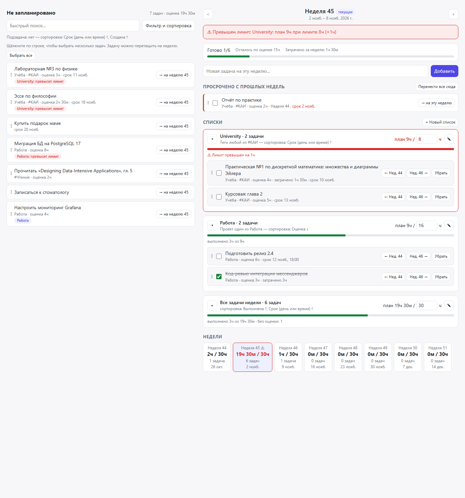

# Week Planner for Super Productivity

Plugin for [Super Productivity](https://github.com/super-productivity/super-productivity) 20+:
plan tasks for whole weeks, not only for single days.

> **Status: early development (0.x).** Things may change between versions.
> Keep the automatic backups of Super Productivity enabled.



## Возможности

- **Неделя у задачи.** Задачу можно прикрепить к ISO-неделе (с понедельника) из контекстного меню задачи или в планировщике.
- **Пул «Не запланировано».** Все невыполненные задачи без недели. Фильтр и сортировка настраиваются по всем полям задачи.
- **Списки с лимитом часов.** Например, «University»: тег #КАИ, сортировка по сроку, не больше 8 ч в неделю. Лимит меняется прямо в заголовке списка.
- **Предупреждение о перегрузке.** Баннер, красная карточка списка, ⚠ на плашке недели и уведомление при превышении лимита.
- **Все задачи недели** в отдельном блоке со своей сортировкой и общим лимитом.
- **Перетаскивание** между пулом, неделей и плашками других недель. Отмена последнего действия.
- **Просроченные задачи** прошлых недель с переносом на текущую неделю в один щелчок.
- Светлая и тёмная тема, русский и английский интерфейс, узкие экраны.

## Установка

1. Скачайте `week-planner-<версия>.zip` со страницы [Releases](../../releases).
2. В Super Productivity откройте «Настройки → Плагины».
3. Загрузите ZIP-архив и включите плагин.

> **Не удаляйте плагин перед обновлением.** Super Productivity удаляет данные плагина
> вместе с плагином. Загружайте новый ZIP поверх установленной версии.

## Где хранятся данные

Плагин хранит данные через `persistDataSynced`, поэтому они синхронизируются между устройствами:

- `t_<id задачи>` — неделя задачи, например `2026-W46`;
- `cfg` — фильтр пула, списки, сортировки и лимиты.

Автоматические копии Super Productivity на Windows лежат в `%APPDATA%\superProductivity\backups`.
Данные плагина находятся в них под ключами `week-planner:t_…` и `week-planner:cfg`.

## Ограничения

- В API плагинов нет способа показать неделю на строке задачи в самом приложении. Неделю видно только в планировщике.
- Часы списка — сумма оценок задач, включая выполненные. Задача без оценки даёт 0 ч.
- Если на неделе есть родительская задача и её подзадача, их часы сложатся дважды. Поэтому пул по умолчанию скрывает подзадачи.
- Списки и лимиты общие для всех недель.

## Разработка

```sh
npm install          # jsdom for tests
npm test             # syntax check + UI smoke test in jsdom
npm run screenshots  # renders screenshots/ with headless Edge/Chrome
pwsh scripts/build.ps1   # dist/week-planner-<version>.zip
```

Структура:

- `week-planner/manifest.json`, `plugin.js` — контекстное меню, кнопка в шапке, хуки.
- `week-planner/index.html` — интерфейс планировщика (iframe, весь CSS и JS внутри).
- `tests/` — фейковый `PluginAPI` с тестовыми данными и smoke-тест.

## License

[MIT](LICENSE)
