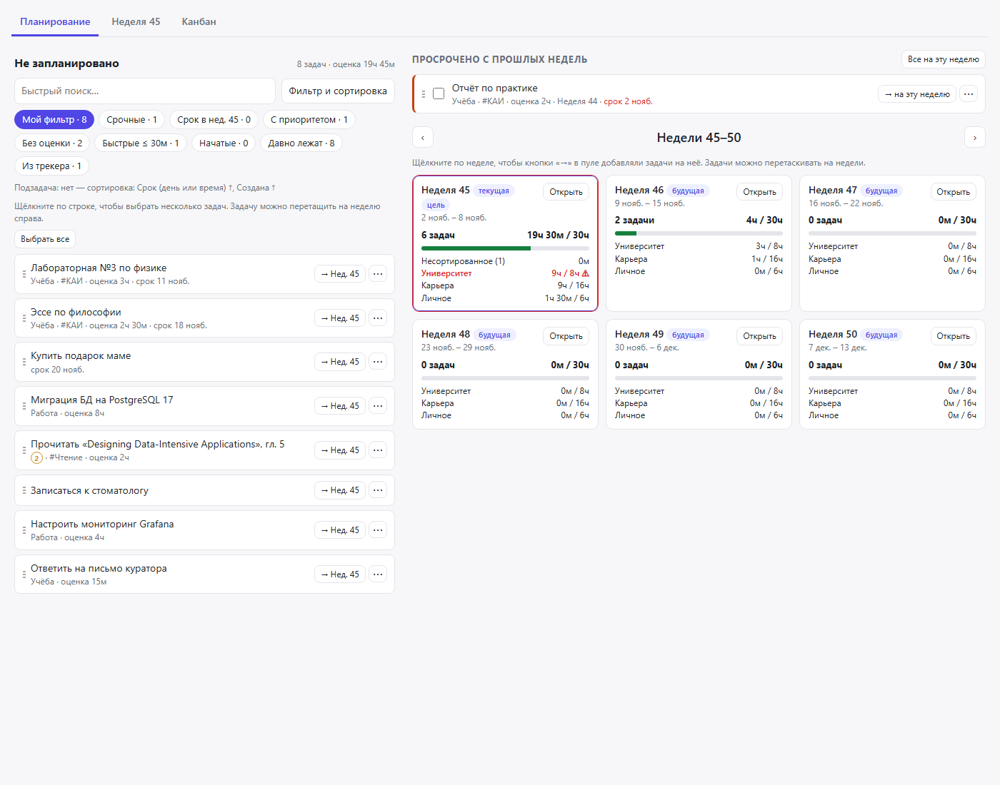
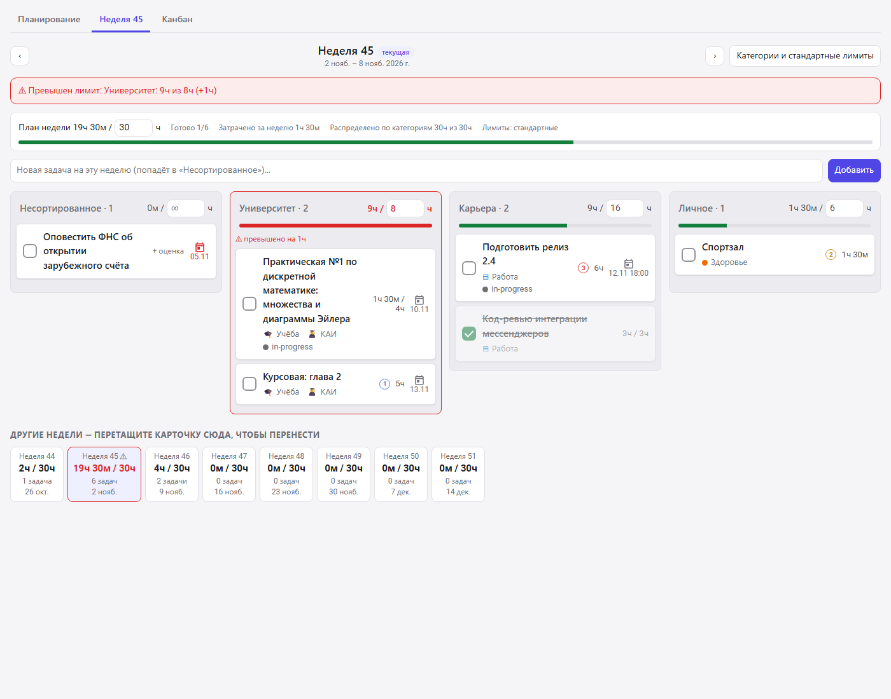
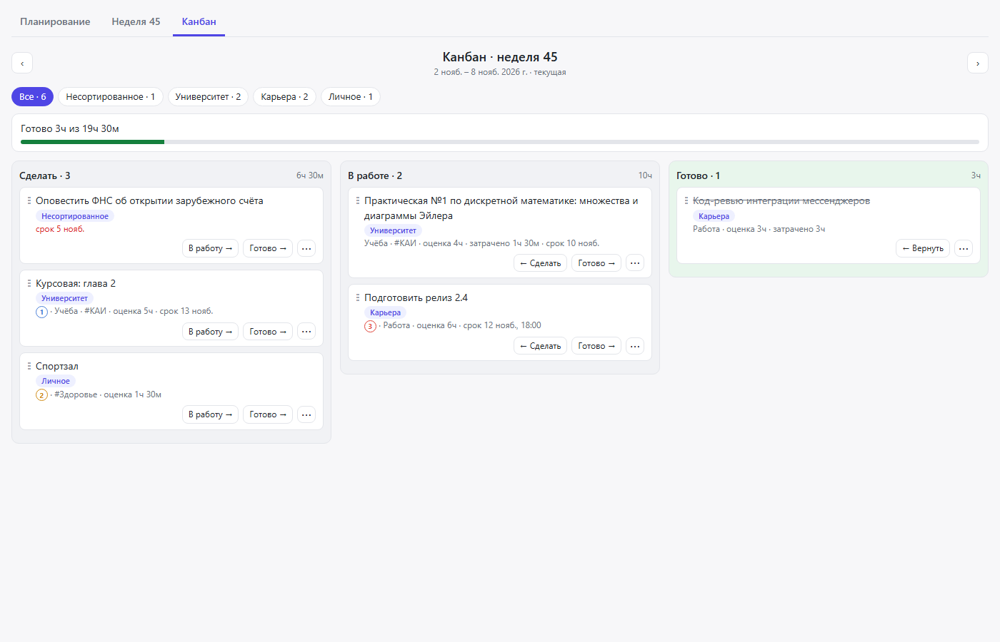
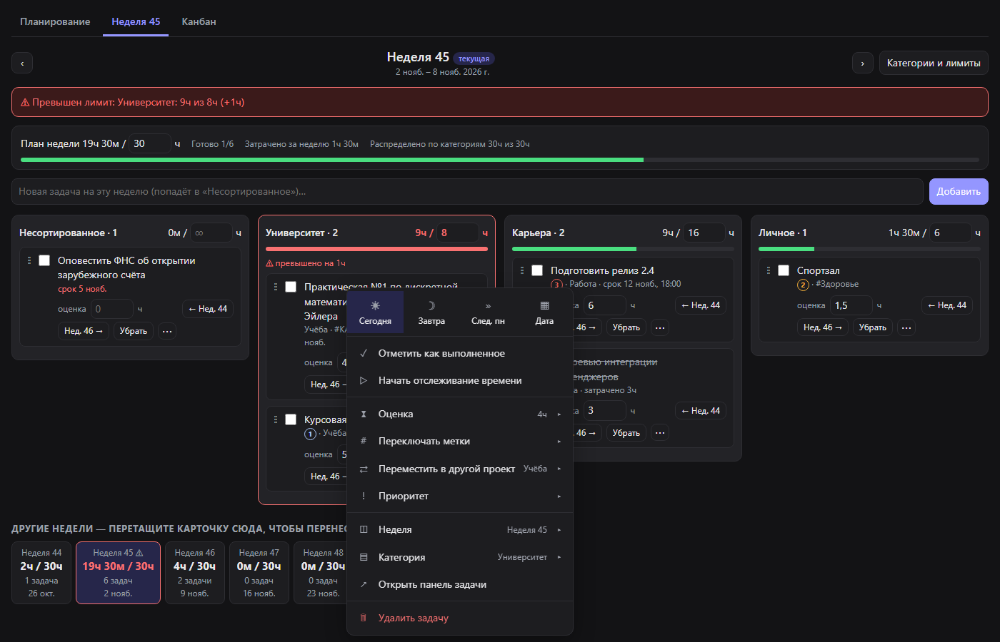

# Week Planner for Super Productivity

Plugin for [Super Productivity](https://github.com/super-productivity/super-productivity) 20+:
plan tasks for whole weeks, sort them into categories with hour limits, and work through the week on a kanban board.

> **Status: early development (0.x).** Things may change between versions.
> Keep the automatic backups of Super Productivity enabled.

## Экраны

Плагин открывается кнопками в верхней панели Super Productivity: «План недели» и «Канбан недели».
Внутри есть 3 вкладки.

### Планирование



- Слева — пул «Не запланировано»: невыполненные задачи без недели. Фильтр и сортировка настраиваются по всем полям задачи.
- Готовые фильтры пула: «Срочные», «Срок в неделе N», «С приоритетом», «Без оценки», «Быстрые ≤ 30м»,
  «Начатые», «Давно лежат», «Из трекера». «Мой фильтр» настраивается кнопкой «Фильтр и сортировка».
- Справа — 6 ближайших недель. В каждой видно загрузку по категориям и общий план недели.
- Задачу можно перетащить на неделю или добавить кнопкой «→ Нед. N». Щелчок по неделе выбирает, куда добавляют кнопки.
- Сверху — просроченные задачи прошлых недель с переносом на текущую неделю.

### Неделя



- Колонки — категории: «Несортированное», «Университет», «Карьера», «Личное».
- Новые задачи недели попадают в «Несортированное». Перетащите карточку в нужную категорию.
- Карточки выглядят как на доске Super Productivity: флажок, заголовок, проект и метки с иконками, приоритет, оценка, срок.
- На карточке нет кнопок, кроме «⋯» при наведении. Перенос между неделями и «Убрать из недели» — в меню задачи.
- Щелчок по оценке на карточке («1ч» или «+ оценка») открывает выбор оценки.
- У каждой категории свой лимит часов, у недели — общий лимит. При превышении появляются баннер, красная колонка и уведомление.
- Сумма лимитов категорий не может быть больше лимита недели.
- Карандаш справа от названия колонки открывает фильтр и сортировку этой колонки. Фильтр только скрывает карточки:
  часы и лимиты учитывают все задачи колонки, а в заголовке видно «скрыто N». Настройки действуют на все недели.
- Категории и **стандартные лимиты** задаются кнопкой «Категории и стандартные лимиты». Их получают все недели.
- Лимиты в заголовках колонок и на панели меняют **только эту неделю**. После первой правки неделя получает
  свои лимиты, и новые стандартные лимиты её больше не меняют. Кнопка «Вернуть стандартные» отменяет свои лимиты недели.

### Канбан



- Колонки «Сделать», «В работе», «Готово» для текущей недели.
- Перенос в «Готово» отмечает задачу выполненной в Super Productivity.
- Колонка «В работе» связана с меткой `#in-progress` в обе стороны. Перенос в «В работе» ставит метку, уход из колонки снимает её.
  Метка, поставленная или снятая в самом Super Productivity, переносит карточку при следующем обновлении плагина.
  Если метки нет, плагин создаёт её сам. При первом запуске задачи, которые уже стояли в «В работе», получают метку.
- Статус меняется перетаскиванием, флажком на карточке или пунктом «Статус» в меню задачи.
- Фильтр по категориям сверху.
- У колонок канбана тоже есть карандаш с фильтром и сортировкой.
- Ручной порядок: перетащите карточку на другую карточку, и она встанет перед ней или после неё.
  Колонка при этом переходит на сортировку «Ручной порядок». Вернуть прежнюю сортировку можно карандашом.

### Меню задачи



Щелчок правой кнопкой по любой карточке (или кнопка «⋯» на ней) открывает меню, похожее на нативное меню
Super Productivity: срок, выполнение, отслеживание времени, оценка, метки, проект, приоритет, неделя,
категория, панель задачи, удаление. Открыть само нативное меню API плагинов не позволяет.

## Установка

1. Скачайте или соберите `week-planner-<версия>.zip` (см. «Разработка»).
2. В Super Productivity откройте «Настройки → Плагины».
3. Загрузите ZIP-архив и включите плагин.

> **Не удаляйте плагин перед обновлением.** Super Productivity удаляет данные плагина
> вместе с плагином. Загружайте новый ZIP поверх установленной версии — данные сохраняются.

## Где хранятся данные

Плагин хранит данные через `persistDataSynced`, поэтому они синхронизируются между устройствами:

- `t_<id задачи>` — JSON `{"w": "2026-W46", "c": "uni", "s": "todo"}`: неделя, категория, статус на канбане;
  после ручной сортировки добавляются `"o": 3, "os": "todo"` — позиция в колонке канбана и сама колонка;
- `cfg` — категории, стандартные лимиты, фильтр пула и порядок карточек;
- `wl_<неделя>` — свои лимиты недели, например `wl_2026-W45`: `{"week": 30, "cats": {"uni": 10}}`.

Какую вкладку открыть, `plugin.js` передаёт интерфейсу через локальное хранилище `setSecret` (не синхронизируется).

Автоматические копии Super Productivity на Windows лежат в `%APPDATA%\superProductivity\backups`.
Данные плагина находятся в них под ключами `week-planner:t_…` и `week-planner:cfg`.

## Ограничения

- В API плагинов нет способа показать неделю на строке задачи в самом приложении. Неделю видно только в плагине.
- Часы — сумма оценок задач, включая выполненные. Задача без оценки даёт 0 ч.
- Оценку родительской задачи Super Productivity считает по подзадачам, поэтому на её карточке оценку изменить нельзя.
- Статус «В работе» хранит плагин. Он не связан с учётом времени в Super Productivity.
- Поля `priority` нет в публичном `types.ts`. Плагин меняет его через `updateTask`; это работает, только если приложение принимает это поле.
- Пунктов «Не буду делать» нет: в API нет для них полей или методов.

## Разработка

```sh
npm install              # jsdom for tests
npm test                 # syntax check + UI smoke test in jsdom
npm run screenshots      # renders screenshots/ with headless Edge/Chrome
pwsh scripts/build.ps1   # dist/week-planner-<version>.zip
```

- `week-planner/manifest.json`, `plugin.js` — контекстное меню, кнопки в шапке, горячие клавиши, хуки.
- `week-planner/index.html` — интерфейс (iframe, весь CSS и JS внутри).
- `tests/` — фейковый `PluginAPI` с тестовыми данными, smoke-тест и скрипт скриншотов.

## License

[MIT](LICENSE)
